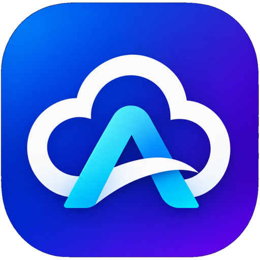

<div align="center">

  

  # Any Cloud

  **Unified, Local-First Multi-Cloud Desktop File Manager**

  *Seamlessly connect, browse, search, and transfer files across 50+ cloud storage services and local drives in one blazing-fast, beautiful Windows desktop application.*

  <p align="center">
    <a href="https://github.com/sayandey021/Any-Cloud/releases"></a>
    <a href="https://v2.tauri.app/"></a>
    <a href="https://www.rust-lang.org/"></a>
    <a href="https://react.dev/"></a>
    <a href="https://rclone.org/"></a>
    <a href="https://microsoft.com/windows"></a>
    <a href="PRIVACY.md"></a>
  </p>

  <p align="center">
    <a href="#key-features">Key Features</a> •
    <a href="#supported-providers">Supported Clouds</a> •
    <a href="#quick-start">Quick Start</a> •
    <a href="#architecture">Architecture</a> •
    <a href="#building--packaging">Build & Package</a> •
    <a href="#privacy--security">Privacy & Security</a>
  </p>

</div>

---

## Overview

**Any Cloud** is a modern desktop multi-cloud manager engineered for Windows 11 and Windows 10. Say goodbye to juggling dozens of browser tabs and heavy background sync clients. Built on **Tauri 2**, **Rust**, and **React**, Any Cloud connects all personal, business, and server storage accounts into a unified, responsive interface with a tiny memory footprint.

Whether moving backups between Amazon S3 and Google Drive, browsing an SFTP server, or managing local folders, Any Cloud provides high-speed, direct transfers and instant offline browsing without routing your data through third-party relay servers.

---

## Key Features

- ⚡ **Ultra-Lightweight & Blazing Fast**  
  Built with Rust and Tauri 2. Consumes under **40 MB idle RAM** (compared to 300MB+ in typical Electron apps) with sub-second launch times and smooth hardware-accelerated animations.

- ☁️ **50+ Cloud Providers & Protocols**  
  Connect consumer clouds, enterprise S3 buckets, FTP/SFTP servers, WebDAV, SMB, and local filesystems in a single dashboard.

- 🔄 **Direct Cross-Cloud Transfers**  
  Transfer files and folders directly between cloud services without manual download-then-upload workflows. Multi-threaded transfer engine provides real-time speed graphs, ETAs, and conflict resolution (*Replace*, *Skip*, *Keep Both*, *Ask*).

- 🔒 **100% Local-First & Zero-Relay Privacy**  
  Zero middleman servers. Authentication tokens and passwords remain strictly on your machine. Data streams point-to-point directly between your PC and your storage endpoints.

- ⚡ **Instant SQLite Caching & Offline Browsing**  
  Visited directories are indexed locally in SQLite (WAL mode). Browse cached file trees in `<5ms` even while offline, and switch between `Live` and `Cached` views with a single click.

- 🔍 **Unified Full-Text Search (FTS5)**  
  Search files, extensions, and paths simultaneously across all connected clouds and local folders with sub-millisecond query execution.

- 🎨 **Windows 11 Fluent Design**  
  Crafted to match modern Windows styling:
  - Deep dark and crisp light themes with acrylic glassmorphism.
  - Dual view modes: visual thumbnail **Grid View** and detailed **List View**.
  - Interactive breadcrumb navigation, Back / Forward / Up controls, and hardware **Mouse 4 & Mouse 5** support.

---

## Supported Providers

Any Cloud leverages [Rclone](https://rclone.org/) under the hood to deliver enterprise-grade protocol support:

| Category | Supported Services & Protocols |
| :--- | :--- |
| **Consumer Cloud** | Google Drive, Microsoft OneDrive, Dropbox, Box, Mega, pCloud, Koofr, Jottacloud, Yandex Disk |
| **Object Storage (S3)** | Amazon S3, Cloudflare R2, Backblaze B2, Google Cloud Storage, MinIO, Wasabi, DigitalOcean Spaces, Oracle Cloud |
| **Network & Protocols** | FTP, FTPS, SFTP (SSH), WebDAV, SMB / Windows Network Shares, HTTP, Local Hard Drives |
| **Specialized & Media** | ImageKit, Cloudinary, Proton Drive, Internxt, Filen, Zoho WorkDrive, and more |

---

## Architecture

Any Cloud pairs a responsive React frontend with a secure, asynchronous Rust desktop runtime. Child processes are spawned without console windows and protected against zombie execution:

```
┌────────────────────────────────────────────────────────┐
│              React 18 + TypeScript UI                 │
│      (Zustand Stores, Tailwind CSS, Lucide Icons)      │
└──────────────────────────┬─────────────────────────────┘
                           │ Tauri IPC Events / Commands
┌──────────────────────────▼─────────────────────────────┐
│                 Tauri 2 Core (Rust)                    │
│  ┌──────────────────────────────────────────────────┐  │
│  │ Local SQLite Cache & Search (WAL Mode + FTS5)    │  │
│  │ - Accounts, Directories, File Metadata, History  │  │
│  └──────────────────────────────────────────────────┘  │
│  ┌──────────────────────────────────────────────────┐  │
│  │ Rclone Process & Transfer Manager                │  │
│  │ - tokio::process::Command                        │  │
│  │ - CREATE_NO_WINDOW (no console flash)            │  │
│  │ - kill_on_drop(true) (safe cancellation)         │  │
│  │ - Streaming JSON stderr / progress telemetry     │  │
│  └──────────────────────────────────────────────────┘  │
└──────────────────────────┬─────────────────────────────┘
                           │
             ┌─────────────┴─────────────┐
             ▼                           ▼
    Local Disks & Network        Direct Cloud APIs
    (C:\, D:\, SMB, etc.)        (Google, AWS, Azure...)
```

For more details on process isolation and database schema, see [`docs/architecture.md`](docs/architecture.md).

---

## Requirements

- **Operating System:** Windows 10 (Build 17763+) or Windows 11 (x64)
- **Node.js:** v18.0 or later and `npm`
- **Rust:** Stable toolchain (`rustc` and `cargo`)
- **Tauri Prerequisites:** See [Tauri 2 Prerequisites](https://v2.tauri.app/start/prerequisites/)
- **Rclone:** Required for cloud operations.
  - Automatically recognized if placed in:
    - Application directory
    - `bin/rclone.exe`
    - `%APPDATA%\AnyCloud\bin\rclone.exe`
    - System `PATH`

---

## Quick Start

### 1. Clone the Repository

```sh
git clone https://github.com/sayandey021/Any-Cloud.git
cd "Any Cloud"
```

### 2. Install Dependencies

```sh
npm ci
```

### 3. Run the Desktop App (Development)

```sh
npm run start
```

> **Note:** To preview only the Vite frontend in a browser without native Tauri capabilities, run `npm run dev`.

---

## Building & Packaging

### Frontend Type-Check & Build
```sh
npm run build
```

### Rust & Desktop App Build
```sh
npm run desktop:build
```

### Run Automated Tests
```sh
cargo test --workspace
```

### Package for Microsoft Store (MSIX)
A preconfigured script is provided to create signed or Store-ready `.msix` packages:

```sh
# Double-click or run from command prompt:
build-msix.bat
```

The output will be placed in `target/msix/` ready for submission to the Microsoft Partner Center. See [`STORE_LISTING.md`](STORE_LISTING.md) for pre-formatted store descriptions and metadata.

---

## Repository Structure

```text
.
├── src/
│   └── frontend/
│       ├── components/     # UI components (Explorer, Clouds, Transfers, Settings)
│       ├── stores/         # Zustand state stores (accounts, files, transfers, theme)
│       ├── services/       # Tauri IPC client wrappers
│       └── styles/         # Tailwind CSS & theme tokens
├── src-tauri/
│   ├── src/                # Rust backend: commands, DB cache, process manager
│   ├── Cargo.toml          # Rust dependencies & configuration
│   └── tauri.conf.json     # Tauri 2 app manifest and window settings
├── scripts/                # Packaging, MSIX builder, and version scripts
├── docs/                   # Technical architecture & design documentation
├── public/                 # Static assets and icons
├── STORE_LISTING.md        # Microsoft Store listing submission kit
└── PRIVACY.md              # Privacy policy and local data handling guidelines
```

---

## Privacy & Security

Any Cloud is built with a **zero-relay, zero-knowledge** architecture:
- **No Relay Servers:** Transfers stream directly between your computer and your cloud providers.
- **Local Credential Storage:** OAuth tokens, access keys, and remote configurations are stored strictly on your local machine in `%APPDATA%\AnyCloud` (or `./anycloud_data` fallback).
- **Secure Authentication:** Uses OAuth 2.0 loopback with PKCE for providers like Google Drive and Microsoft OneDrive.
- **Zero Telemetry Tracking:** No behavioral tracking, user profiling, or sale of user data.

For comprehensive details, review our full [Privacy Policy](PRIVACY.md).

---

## Contributing

Contributions, feature suggestions, and bug reports are warmly welcome!

1. Fork the repository.
2. Create your feature branch (`git checkout -b feature/amazing-feature`).
3. Commit your changes (`git commit -m "Add amazing feature"`).
4. Push to the branch (`git push origin feature/amazing-feature`).
5. Open a Pull Request.

---

## License & Acknowledgements

- Built with [Tauri](https://v2.tauri.app/) and [Rust](https://www.rust-lang.org/).
- Cloud engine powered by [Rclone](https://rclone.org/).
- UI icons by [Lucide](https://lucide.dev/).
- Copyright &copy; 2026 SaayanSoft. All rights reserved.
